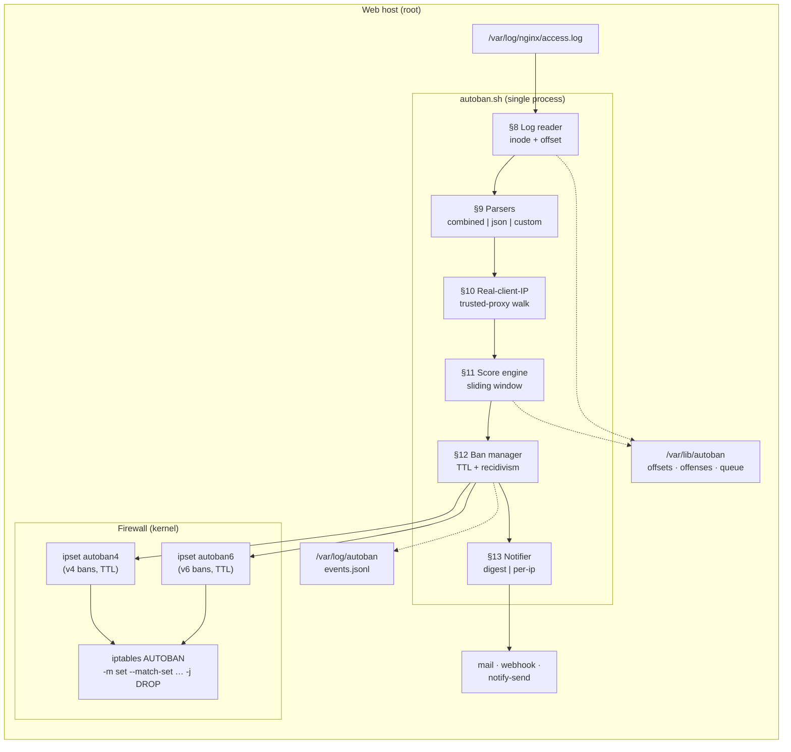
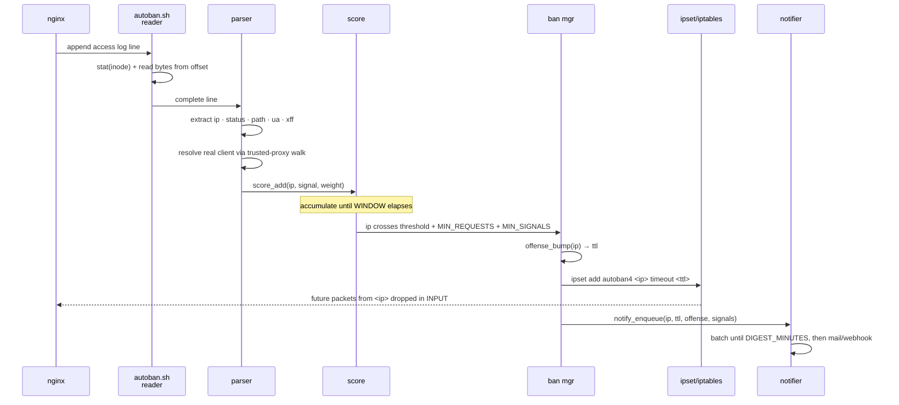

# AutoBan

**Adaptive, log-driven IP ban daemon for nginx / Apache / HAProxy.**

Built on `ipset` + `iptables` (`iptables-nft` on modern distros). Sliding-window
scoring, TTL bans with recidivism escalation, CIDR-correct whitelist, and
digest alerting — in a single auditable shell script.

**Maintained by [`D0T_SL_CE"I_"`](https://github.com/DoTMob/)**

[](#changelog)
[](#license)
[](#requirements)
[](#requirements)
[](#)

---

**Adaptive, log-driven IP ban daemon for nginx / Apache / HAProxy.**

Built on `ipset` + `iptables` (`iptables-nft` on modern distros). Sliding-window
scoring, TTL bans with recidivism escalation, CIDR-correct whitelist, and
digest alerting — in a single auditable shell script.

[](#changelog)
[](#license)
[](#requirements)
[](#requirements)

> ### ⚠️ Defensive tooling only
>
> AutoBan reads **your own** web-server logs and modifies **your own** host
> firewall. It does **not** probe, scan, or send traffic to any remote host,
> and it never spoofs source addresses. There is no attack-generation
> capability in this repository. If you need to test it against another host,
> that host must be one you own and control, and you must have written
> authorization for the test.

---

## Table of contents

- [Why AutoBan](#why-autoban)
- [Architecture](#architecture)
- [Threat model](#threat-model)
- [How it decides](#how-it-decides)
- [Files](#files)
- [Requirements](#requirements)
- [Install](#install)
- [First run (dry-run — mandatory)](#first-run-dry-run--mandatory)
- [Usage](#usage)
- [Configuration reference](#configuration-reference)
- [Log formats](#log-formats)
- [Threat feeds (auto-update)](#threat-feeds-auto-update)
- [Operations & monitoring](#operations--monitoring)
- [Rollback / uninstall](#rollback--uninstall)
- [Safety warnings](#safety-warnings)
- [Troubleshooting](#troubleshooting)
- [Testing](#testing)
- [Changelog](#changelog)
- [License](#license)

---

## Why AutoBan

`fail2ban` is a capable tool, but it is large, Python-based, and its
jail/filter/action model is non-obvious to audit. AutoBan is deliberately the
opposite: **one shell script you can read end-to-end in an afternoon**, with
all 30+ knobs in one config file, one state directory, and one JSON event log.

| Feature | fail2ban | AutoBan |
|---|---|---|
| Language | Python (~40k LOC + jails) | Bash (~1,000 LOC, one file) |
| Ban storage | Per-jail files + `iptables` | `ipset` with native TTL, O(1) match |
| CIDR whitelist | Filter-based, per-jail | `ipset hash:net`, single source of truth |
| IPv6 | Per-jail | Built-in (`ip6tables` + `ipset inet6`) |
| XFF / real-IP | Per-filter config | Trusted-proxy walk, one switch |
| Decision model | First-match regex | Weighted score + multi-signal gate |
| Recidivism | Repeat-offender actions | `DEFAULT_TTL × TTL_STEP^(n-1)`, capped |
| Dry-run | Partial | `--dry-run` skips every firewall write |
| Event log | Text log | JSON Lines (`events.jsonl`) |
| Rollback | Per-jail unban | `autoban.sh teardown` (one command) |

If you already run `fail2ban` and are happy with it, keep it. AutoBan exists for
operators who want a **small, explainable, ipset-native** layer they can audit
line by line.

---

## Architecture



### Request lifecycle



### State directory layout

```text
/var/lib/autoban/
├── autoban.lock              # flock — single instance enforcement
├── logstate.access.log       # <inode>:<offset> for rotation-safe reads
├── notify_queue              # digest buffer (one "ts|ip|ttl|off|sig" per ban)
└── offenses/
    ├── 203.0.113.5            # "3" — offense count, drives TTL escalation
    └── 198.51.100.44          # "1"
```

---

## Threat model

| In scope | Out of scope |
|---|---|
| Single-IP / small-CIDR HTTP abuse: scanners, brute force, path probing, credential stuffing, bad UAs | Volumetric L3/L4 DDoS (use BGP RTBH / scrubbers) |
| Recidivism: escalating TTL for repeat offenders | DNS amplification (see sibling project) |
| Log-driven thresholds you can tune and audit | Endpoint compromise, lateral movement |
| Misconfigured XFF chains and wrong-IP bans (mitigated by trusted-proxy walk) | Application-layer business-logic abuse |
| Bad bot / known scanner user-agents | Zero-days, WAF-level request shaping |

AutoBan is a **rate-limiting and recidivism control**, not a WAF. It decides on
aggregate behavior across a sliding window, not on individual request content.

---

## How it decides

```mermaid
flowchart TD
    L[log line] --> P{parse}
    P -- fail --> D[drop]
    P -- ok --> IP{valid IP?}
    IP -- no --> D
    IP -- yes --> X[resolve real client IP<br/>trusted-proxy walk]
    X --> W{whitelisted?}
    W -- yes --> D
    W -- no --> M{manual ban?}
    M -- yes --> D
    M -- no --> SC[score_add<br/>request=1 · 4xx=5 · 5xx=8<br/>path=10 · ua=10]

    SC --> G{score ≥ BAN_THRESHOLD<br/>AND<br/>count ≥ MIN_REQUESTS<br/>AND<br/>signals ≥ MIN_SIGNALS}
    G -- no --> NEXT[next line]
    G -- yes --> OFF[offense_bump]
    OFF --> TTL[ttl = DEFAULT × TTL_STEP^&#40;n−1&#41;<br/>capped at MAX_TTL]
    TTL --> DRY{--dry-run?}
    DRY -- yes --> LOG1[log would_ban]
    DRY -- no --> ADD[ipset add autoban4&#40;6&#41;<br/>timeout TTL]
    ADD --> NQ[notify_enqueue]
    NQ --> NEXT
```



### Signal weights (configurable)

| Signal | Trigger | Default weight | Why |
|---|---|---:|---|
| `request` | any request | **1** | Establishes a baseline for every IP |
| `4xx` | status 400–499 | **5** | Path probing, missing-auth, bad params |
| `5xx` | status 500–599 | **8** | Server-error floods or broken clients |
| `path` | `SCAN_PATH_REGEX` matches `.env`, `wp-login.php`, `.git`, etc. | **10** | Classic exploitation paths |
| `ua` | `BAD_UA_REGEX` matches sqlmap, nikto, nuclei, etc. | **10** | Known offensive tooling |

The three-way gate (`BAN_THRESHOLD` + `MIN_REQUESTS` + `MIN_SIGNALS`) is what
distinguishes AutoBan from `maxconn=1`-style tools: a single request from a NAT
or a CDN edge can never produce a ban.

### TTL escalation (recidivism)

```text
offense  #1:  DEFAULT_TTL × TTL_STEP^0   =   3600 s   ( 1 hour)
offense  #2:  DEFAULT_TTL × TTL_STEP^1   =   7200 s   ( 2 hours)
offense  #3:  DEFAULT_TTL × TTL_STEP^2   =  14400 s   ( 4 hours)
offense  #4:  DEFAULT_TTL × TTL_STEP^3   =  28800 s   ( 8 hours)
offense  #5:  DEFAULT_TTL × TTL_STEP^4   =  57600 s   (16 hours)
...capped at MAX_TTL (default 604800 s = 7 days)
```

Offense counters live in `/var/lib/autoban/offenses/<ip>` and are reset by
`autoban.sh unban <ip>`.

---

## Files

| File | Type | Purpose |
|---|---|---|
| `autoban.sh` | **code** | Engine — capture, parse, score, ban, notify, subcommands |
| `autoban-initd` | **code** | SysV shim; delegates to `systemctl` when systemd is present |
| `autoban.service` | config | systemd unit with sandboxing and `ExecReload=SIGHUP` |
| `autoban.conf` | config | Single source of truth: paths, thresholds, lists, notify |
| `whitelist.txt` | data | Never-ban ranges (management, monitoring, CDN egress) |
| `blacklist.txt` | data | Manual/curated bans with `source=` / `until=` annotations |
| `README.md` | docs | This file |

Installed layout:

```text
/opt/autoban/autoban.sh
/etc/autoban/{autoban.conf,whitelist.txt,blacklist.txt}
/etc/systemd/system/autoban.service
/var/lib/autoban/            # state
/var/log/autoban/            # events.jsonl
/run/autoban/                # runtime (systemd-managed)
```

---

## Requirements

| Component | Minimum | Notes |
|---|---|---|
| Linux kernel | 3.x+ | `ipset` support required (any modern distro) |
| `bash` | 4.3+ | Uses `printf -v`, assoc arrays, `read -ra` |
| `ipset` | any | `apt install ipset` / `dnf install ipset` |
| `iptables` | any (incl. `iptables-nft`) | On RHEL 9+ / Debian 12 this is nft-backed |
| `flock` | util-linux | Ships with `util-linux` on every distro |
| `ip6tables` | optional | Only needed for IPv6 bans |
| `curl` | optional | Webhook notifications |
| `mail` / `sendmail` | optional | Email notifications |
| `notify-send` | optional | Desktop notifications (WSLg, X, Wayland) |
| `systemctl` | optional | Recommended; SysV path exists via `autoban-initd` |

Root (or `CAP_NET_ADMIN`) is required for `ipset` and `iptables` operations.

---

## Install

### systemd (recommended)

```bash
# From a clone of this repo:
sudo ./autoban.sh install
```

`install` performs these steps idempotently:

1. Copies `autoban.sh` to `/opt/autoban/`
2. Copies `autoban.conf`, `whitelist.txt`, `blacklist.txt` to `/etc/autoban/`
   (existing files are preserved)
3. Copies `autoban.service` to `/etc/systemd/system/`
4. Creates `/var/lib/autoban` and `/var/log/autoban`
5. `systemctl daemon-reload && systemctl enable --now autoban`

**Before** enabling the service, run the config check and a dry-run:

```bash
sudo /opt/autoban/autoban.sh --config /etc/autoban/autoban.conf check
```

### SysV-only distributions

```bash
sudo cp autoban-initd /etc/init.d/autoban
sudo chmod 755 /etc/init.d/autoban
sudo update-rc.d autoban defaults    # Debian / Ubuntu
# or: sudo chkconfig --add autoban   # RHEL / CentOS legacy
```

`autoban-initd` reads `/opt/autoban/autoban.sh` and `/etc/autoban/autoban.conf`,
so you still need to place those files as in the systemd install, then:

```bash
sudo service autoban start
```

---

## First run (dry-run — mandatory)

```bash
# 1. Copy default files into place.
sudo cp autoban.conf   /etc/autoban/autoban.conf
sudo cp whitelist.txt  /etc/autoban/whitelist.txt
sudo cp blacklist.txt  /etc/autoban/blacklist.txt

# 2. Edit /etc/autoban/autoban.conf. At minimum set:
#      NGINX_LOG      — the actual path to your web-server access log
#      TRUSTED_PROXIES — your CDN / load-balancer CIDRs, if any
#      MAIL_TO        — where digests should go
#    And review whitelist.txt for CDN/management ranges.

# 3. Confirm the parser understands your log line:
sudo /opt/autoban/autoban.sh --config /etc/autoban/autoban.conf \
     test '203.0.113.5 - - [01/Jan/2025:00:00:00 +0000] "GET /.env HTTP/1.1" 404 0 "-" "nuclei"'
# → ip=203.0.113.5  status=404  path=/.env  ua=nuclei  xff=

# 4. Dry-run for 24h. Nothing touches the firewall.
sudo /opt/autoban/autoban.sh --config /etc/autoban/autoban.conf --dry-run run

# 5. Watch what it would have done:
tail -f /var/log/autoban/events.jsonl | jq -c 'select(.event=="would_ban")'
```

When the dry-run log matches your expectations, drop `--dry-run` (or start the
systemd service) to enable enforcement:

```bash
sudo systemctl restart autoban
```

---

## Usage

### Command-line

```text
autoban.sh [options] [command]

Commands:
  run           Start the daemon (default)
  status        Show current ban counts and config paths
  list          List currently banned IPs
  unban <ip>    Remove an IP from the ban set
  test <line>   Parse one log line and show extracted fields
  check         Validate config and dependencies without running
  install       Install unit, config, lists, and enable service
  uninstall     Disable service and tear down firewall objects
  teardown      Remove firewall objects only (keep service files)

Options:
  -c, --config <file>   Config file (default: /etc/autoban/autoban.conf)
      --dry-run         Do not modify firewall; log intended actions
      --replay          Process log from the beginning on first run
      --once            Run a single poll cycle then exit
  -v, --verbose         Per-line parse logging to stderr
  -h, --help            Help
      --version         Print version
```

### Common operations

```bash
# Status snapshot
sudo autoban.sh status

# Currently banned IPs
sudo autoban.sh list

# Unban one IP (also clears its offense counter)
sudo autoban.sh unban 203.0.113.5

# Reload config and lists WITHOUT dropping existing bans
sudo systemctl reload autoban        # sends SIGHUP
# or (SysV):
sudo service autoban reload

# Dump stats to syslog on demand
sudo kill -USR1 $(cat /var/run/autoban.pid)

# Watch decisions live
tail -f /var/log/autoban/events.jsonl | jq .

# Watch only bans and would-be bans
tail -f /var/log/autoban/events.jsonl \
  | jq -c 'select(.event=="ban" or .event=="would_ban")'
```

### Signals

| Signal | Effect |
|---|---|
| `SIGTERM` / `SIGINT` | Graceful shutdown — flush digest, exit |
| `SIGHUP` | Reload `autoban.conf` and both list files |
| `SIGUSR1` | Dump `banned4`, `banned6`, `tracked` counters to syslog |

---

## Configuration reference

All keys live in `/etc/autoban/autoban.conf`. Unknown keys are ignored with a
warning (allowlist enforced in `autoban.sh` §1).

### Source log

| Key | Default | Notes |
|---|---|---|
| `NGINX_LOG` | `/var/log/nginx/access.log` | Absolute path |
| `LOG_FORMAT` | `combined` | `combined` / `json` / `custom` |
| `PARSE_REGEX` | _(empty)_ | Required iff `LOG_FORMAT=custom` |

### Real-client-IP

| Key | Default | Notes |
|---|---|---|
| `TRUSTED_PROXIES` | `127.0.0.1/32,::1/128` | CIDRs allowed to set XFF |
| `USE_XFF` | `auto` | `auto` / `yes` / `no` |

### Detection

| Key | Default | Notes |
|---|---|---|
| `WINDOW_SECONDS` | `60` | Sliding window |
| `BAN_THRESHOLD` | `40` | Score threshold |
| `MIN_REQUESTS` | `15` | ≥ 2 enforced |
| `MIN_SIGNALS` | `2` | ≥ 1 enforced |
| `SCAN_PATH_REGEX` | see example | POSIX ERE |
| `BAD_UA_REGEX` | see example | POSIX ERE |

### Ban lifecycle

| Key | Default | Notes |
|---|---|---|
| `DEFAULT_TTL` | `3600` | Base ban, seconds |
| `TTL_STEP` | `2` | Recidivism multiplier |
| `MAX_TTL` | `604800` | Hard cap, 7 days |

### Lists

| Key | Default | Notes |
|---|---|---|
| `NEVER_BAN` | `/etc/autoban/whitelist.txt` | Never-ban file |
| `MANUAL_BAN` | `/etc/autoban/blacklist.txt` | Manual ban file |
| `PROTECTED_RANGES` | RFC1918 + loopback + link-local | Always applied |

### Firewall

| Key | Default | Notes |
|---|---|---|
| `IPSET_NAME` | `autoban4` | Runtime IPv4 set |
| `IPSET_NAME6` | `autoban6` | Runtime IPv6 set |

### Notifications

| Key | Default | Notes |
|---|---|---|
| `NOTIFY` | `digest` | `none` / `digest` / `per-ip` |
| `DIGEST_MINUTES` | `15` | Digest cadence |
| `MAIL_TO` | `admin@example.com` | Email recipient |
| `WEBHOOK_URL` | _(empty)_ | Generic JSON webhook |

### Runtime

| Key | Default | Notes |
|---|---|---|
| `POLL_INTERVAL` | `5` | Seconds between reads |
| `STATE_DIR` | `/var/lib/autoban` | Offsets, offenses, queue |
| `LOGS_DIR` | `/var/log/autoban` | `events.jsonl` |

---

## Log formats

### nginx — combined (default)

Works out of the box with the standard `combined` format.

### nginx — JSON

```nginx
log_format json_combined escape=json
  '{"time":"$time_iso8601",'
   '"remote_addr":"$remote_addr",'
   '"status":$status,'
   '"request_uri":"$request_uri",'
   '"http_user_agent":"$http_user_agent",'
   '"http_x_forwarded_for":"$http_x_forwarded_for"}';
access_log /var/log/nginx/access.log json_combined;
```

Then:

```ini
LOG_FORMAT=json
```

### Apache — vhost_combined

```ini
LOG_FORMAT=custom
PARSE_REGEX=^(\S+) \S+ \S+ \[[^]]+\] "\S+ ([^"]*)" ([0-9]{3}) \S+ "([^"]*)" "([^"]*)"
```

### Custom — rule of thumb

Capture groups must be exactly:

1. client IP
2. status code
3. request path
4. user-agent
5. x-forwarded-for (may be empty)

Anchor with `^...$` where possible. Avoid nested quantifiers to prevent ReDoS.

---

## Threat feeds (auto-update)

`blacklist.txt` supports manual entries, but static lists rot. The recommended
pattern is to have a small cron/timer job refresh the file from public feeds
and reload the daemon.

### Minimal feed update script

```bash
#!/bin/bash
# /usr/local/sbin/autoban-feed-update.sh
set -euo pipefail

FEEDS=/var/lib/autoban/feeds
MANUAL=/etc/autoban/blacklist.manual
TARGET=/etc/autoban/blacklist.txt
TMP=$(mktemp /tmp/blacklist.XXXXXX)
trap 'rm -f "$TMP"' EXIT

mkdir -p "$FEEDS"

# Spamhaus DROP (v4)
curl -fsSL --max-time 30 https://www.spamhaus.org/drop/drop.txt \
  | awk -F';' '/^[0-9]/{gsub(/ /,"",$1); print $1 "  # source=spamhaus-drop"}' \
  >> "$TMP" || true

# DShield top-20 /24s
curl -fsSL --max-time 30 https://feeds.dshield.org/block.txt \
  | awk -F'\t' '/^[0-9]/{print $1 "/24  # source=dshield"}' \
  >> "$TMP" || true

# Manual/curated block (if present) is preserved verbatim
[[ -f "$MANUAL" ]] && cat "$MANUAL" >> "$TMP"

sort -u "$TMP" > "$TARGET"
systemctl reload autoban
```

```cron
# /etc/cron.d/autoban-feeds
17 3 * * *  root  /usr/local/sbin/autoban-feed-update.sh
```

Suggested public feeds (verify licensing before relying on them):

| Feed | Source | Notes |
|---|---|---|
| Spamhaus DROP | `spamhaus.org/drop/drop.txt` | "Do not route" — safe for firewall use |
| Spamhaus EDROP | `spamhaus.org/drop/edrop.txt` | Hijacked netblocks |
| DShield | `feeds.dshield.org/block.txt` | Top-20 attacking /24s, hourly |
| FireHOL L1 | `raw.githubusercontent.com/firehol/blocklist-ipsets/master/firehol_level1.netset` | Curated, conservative |
| Blocklist.de | `lists.blocklist.de/lists/all.txt` | Broad, more false positives |
| Tor exits | `check.torproject.org/torbulkexitlist` | Decide whether you *want* to ban Tor |
| Emerging Threats | `rules.emergingthreats.net/fwrules/emerging-Block-IPs.txt` | Known-bad IPs |
| AbuseIPDB | `api.abuseipdb.com/api/v2/blacklist` (key) | Requires API key — keep in `/etc/autoban/feeds.env`, mode `0600` |

**Curated entries belong in `blacklist.manual`**, never in the generated
`blacklist.txt` (the update script overwrites the latter). Keep annotations
(`source=`, `until=`) so entries remain auditable.

---

## Operations & monitoring

### Structured event log

Every ban, unban, reload, start, and stop is written as one JSON object per
line to `/var/log/autoban/events.jsonl`:

```json
{"ts":"2025-01-15T14:02:11Z","pid":1042,"event":"start","config":"/etc/autoban/autoban.conf","dry_run":"no"}
{"ts":"2025-01-15T14:05:37Z","pid":1042,"event":"ban","ip":"203.0.113.5","ttl":"3600","offense":"1","signals":"request,4xx,path"}
{"ts":"2025-01-15T14:05:37Z","pid":1042,"event":"notify_sent","count":"1"}
{"ts":"2025-01-15T14:20:00Z","pid":1042,"event":"reload","event_extra":"sighup"}
{"ts":"2025-01-15T15:02:11Z","pid":1042,"event":"stop"}
```

### Useful jq one-liners

```bash
# All bans in the last hour
jq -c 'select(.event=="ban")' /var/log/autoban/events.jsonl \
  | jq -c 'select(.ts > (now - 3600 | todate))'

# Top banned IPs
jq -r 'select(.event=="ban") | .ip' /var/log/autoban/events.jsonl \
  | sort | uniq -c | sort -rn | head

# Signals that produced bans
jq -r 'select(.event=="ban") | .signals' /var/log/autoban/events.jsonl \
  | tr ',' '\n' | sort | uniq -c | sort -rn
```

### Prometheus (optional)

The event log is line-delimited JSON, so a trivial exporter can feed it into
any metrics pipeline. If you want a ready-made scrape target, wrap
`autoban.sh status` in a `node_exporter` textfile collector:

```bash
# /usr/local/bin/autoban-textfile.sh  (run every 60 s by cron)
{
  echo "# HELP autoban_banned_ipv4 Currently banned IPv4 addresses"
  echo "# TYPE autoban_banned_ipv4 gauge"
  echo "autoban_banned_ipv4 $(sudo autoban.sh status | awk -F': *' '/banned4/{print $2}')"
  echo "autoban_banned_ipv6 $(sudo autoban.sh status | awk -F': *' '/banned6/{print $2}')"
} > /var/lib/node_exporter/textfile/autoban.prom.tmp
mv /var/lib/node_exporter/textfile/autoban.prom.tmp \
   /var/lib/node_exporter/textfile/autoban.prom
```

### Log rotation

`autoban.sh` tracks `(inode, byte-offset)` in `$STATE_DIR/logstate.<name>`:

- **`logrotate` with `create`** (default): new inode is detected → reset to 0.
- **`logrotate` with `copytruncate`**: size shrinks → reset to 0.
- **No rotation**: continues reading new bytes.

No `/etc/logrotate.d/` stanza is required for AutoBan itself. Add one for
`/var/log/autoban/events.jsonl` if it grows unbounded:

```conf
/var/log/autoban/events.jsonl {
    weekly
    rotate 8
    compress
    missingok
    notifempty
    copytruncate
}
```

---

## Rollback / uninstall

```bash
# Remove firewall objects only; keep service files and config.
sudo autoban.sh teardown

# Full uninstall: stop the service, remove the unit, tear down the firewall.
sudo autoban.sh uninstall
```

`teardown` and `uninstall` both remove:

- the `AUTOBAN` iptables chain and its jump from `INPUT`
- the `AUTOBAN` ip6tables chain and its jump from `INPUT`
- the `autoban4` and `autoban6` runtime sets
- the `autoban*_never4/6`, `autoban*_manual4/6`, `autoban*_trusted4/6` sets

If a bad threshold has locked out legitimate traffic, `teardown` is your
one-command recovery — the service keeps running, but no new traffic is
dropped until the chain is recreated.

---

## Safety warnings

These are the guardrails that separate AutoBan v2 from the original tool.
Each one is either enforced in code or by config validation.

### 1. Start in dry-run for at least 24 hours

`--dry-run` skips every `ipset add` call. Each intended ban is logged as
`would_ban` in `events.jsonl`. Review the log for false positives before
enabling enforcement.

### 2. `MIN_REQUESTS` is enforced at ≥ 2

The original tool used `maxconn=1`, meaning **one matching line could ban an
IP** — including a shared NAT, an office router, or a CDN edge serving
thousands of real users. `autoban.sh` refuses to start if `MIN_REQUESTS < 2`.

### 3. Whitelist is checked before scoring

Anything in `whitelist.txt` or `PROTECTED_RANGES` is never scored and never
banned, regardless of how many signals it fires. `PROTECTED_RANGES` is
applied on every start, so a truncated or empty `whitelist.txt` cannot expose
your LAN.

### 4. CDN egress ranges belong in `whitelist.txt`

Banning Cloudflare, Fastly, or CloudFront does not ban attackers — it locks
out the legitimate visitors those CDNs are proxying. Keep CDN ranges in
`whitelist.txt`. The original tool shipped them in `blacklist.txt`, which is
inverted; v2 moves them.

### 5. `X-Forwarded-For` is only trusted from `TRUSTED_PROXIES`

If a client sets XFF and the socket peer is not in `TRUSTED_PROXIES`, the
socket IP is used instead. Without this check, any client can force AutoBan
to ban an innocent third party by sending a spoofed header.

### 6. `/0` and prefixes shorter than `/8` are refused

`FORCE_BROAD=yes` in the environment is required to load them. A single
mis-typed line like `0.0.0.0/0` in `whitelist.txt` would otherwise disable
all enforcement; a similar typo in `blacklist.txt` would block the whole
internet.

### 7. Log format must be verified before enforcement

Run `autoban.sh test '<line>'` with a real log line. If `ip=`, `path=`, or
`ua=` comes back empty, `LOG_FORMAT` is wrong — do **not** enable enforcement
until it is fixed.

### 8. Log rotation is safe by construction

The reader keys state on inode and byte offset, so `logrotate` (`create`) and
`copytruncate` both work without extra config.

### 9. Rollback is one command

`autoban.sh teardown` removes every ipset set and chain AutoBan created. It
leaves the config and the service files in place so you can re-enable.

### 10. Single-instance enforcement

`flock` on `$STATE_DIR/autoban.lock` prevents a second copy from racing on
the offense store or the notify queue.

### 11. Root is used minimally and visibly

The daemon runs as root because `ipset`/`iptables` require it. The systemd
unit narrows root with `ProtectSystem=full`, `ProtectHome=yes`,
`PrivateTmp=yes`, `RestrictAddressFamilies`, and `RestrictNamespaces`.
Review and tighten `ReadWritePaths` if your layout differs.

### 12. Structured events for post-incident review

`events.jsonl` records every decision with timestamp, IP, TTL, offense count,
and the exact signals that fired. This is what to hand to a SIEM or review
after an incident — not a rolling text log.

---

## Troubleshooting

| Symptom | Likely cause | Fix |
|---|---|---|
| `FATAL: config not found` | `-c` path wrong or `/etc/autoban/autoban.conf` missing | `cp autoban.conf /etc/autoban/` |
| `FATAL: another instance is running` | Leftover process or stale lock | `sudo autoban.sh status`, `kill <pid>` if stale |
| `required command not found: ipset` | `ipset` not installed | `apt install ipset` / `dnf install ipset` |
| Service starts then exits | Log path wrong or unreadable | `sudo autoban.sh check` |
| `parse failed` in `test` | `LOG_FORMAT` wrong for your logs | Set `LOG_FORMAT=json` or `custom` |
| `ua=` empty for combined logs | Your nginx `log_format` omits UA | Use `json` format (see [Log formats](#log-formats)) |
| Nobody is being banned | `MIN_REQUESTS` / `BAN_THRESHOLD` too high, or `--dry-run` still on | Check `events.jsonl` for `would_ban`; lower thresholds |
| Legitimate users are banned | CDN range missing from `whitelist.txt` | Add it, `systemctl reload autoban`, `autoban.sh unban <ip>` |
| Ban doesn't block traffic | `iptables` chain not hooked into `INPUT`, or host firewall takes precedence | `iptables -nL INPUT \| head`; check ordering |
| Events file grows unbounded | No logrotate stanza | Add one (see [Log rotation](#log-rotation)) |

---

## Testing

```bash
# Parse one line without root — quickest smoke test:
./autoban.sh test '203.0.113.5 - - [01/Jan/2025:00:00:00 +0000] "GET /.env HTTP/1.1" 404 0 "-" "nuclei"'
# → ip=203.0.113.5  status=404  path=/.env  ua=nuclei  xff=

# Dependency and config check (no root required for the parsing half):
./autoban.sh --config ./autoban.conf check

# Static analysis — recommended before any PR:
shellcheck -x autoban.sh autoban-initd

# End-to-end in a throwaway VM:
sudo ./autoban.sh install
sudo autoban.sh --dry-run run          # 24h
sudo systemctl start autoban
tail -f /var/log/autoban/events.jsonl | jq .
```

Manual syscall-level verification:

```bash
# Watch ipset membership change when a ban fires
watch -n1 'sudo ipset list autoban4 | head -20'

# Confirm packet drops after a ban
sudo iptables -nvL AUTOBAN
```

---

## Changelog

### v2.0.1

**Correctness and safety refinements over v2.0.0.**

- **Config allowlist** (`VALID_CONFIG_KEYS`): unknown keys are ignored with a
  warning so a typo or hostile config cannot clobber `PATH`, `IFS`, or `HOME`.
- **Partial-line safe log reader**: only complete lines (up to the last
  newline) are emitted per poll; the trailing partial line is read whole on
  the next cycle.
- **Non-blocking status check**: `status` determines liveness via a
  non-blocking `flock`, not `pgrep`.
- **Deterministic time**: `CURRENT_TIME` is cached per poll loop so all lines
  in a batch score against the same timestamp.
- **Hardened parse guards**: `custom` format now requires `PARSE_REGEX`;
  `USE_XFF` and `POLL_INTERVAL` are validated.
- **New `check` subcommand**: validates config, log readability, and
  dependency availability without starting the daemon.
- **Tempfile safety**: per-IP notification uses `mktemp` instead of a fixed
  `/tmp` path.
- **Argument validation**: `unban` and `test` require an argument;
  `--config` requires a value.
- **Expanded regexes**: `SCAN_PATH_REGEX` adds `.aws/credentials` and `.ssh/`;
  `BAD_UA_REGEX` adds `nmap`, `dirbuster`, `wfuzz`, `nuclei`.

### v2.0.0 — first public release

Comprehensive rewrite of the original one-shot script. Fixes nine latent
correctness bugs and adds the full Tier A/B/C feature set:

| # | Bug (original) | Fix |
|---|---|---|
| B1 | `blockedip` iptables chain never created | `fw_init` creates chain + sets idempotently |
| B2 | CIDR whitelist/blacklist compared as literal strings | Loaded into `hash:net` ipsets; `ipset test` |
| B3 | Shared `Num` flag skipped every IP after the first offender | Per-IP scoring state |
| B4 | Undefined `$SPAMDROPMSG` | Removed; literal `autoban-drop` comment |
| B5 | Cloudflare ranges were in `blacklist.txt` (inverted) | Moved to `whitelist.txt` |
| B6 | `tail -n 100` re-read the same lines forever | Inode + offset state, rotation-safe |
| B7 | No instance lock; racy `blacklist.txt` rewrite | `flock`; atomic file ops |
| B8 | `maxconn=1` banned on a single line (self-DoS) | Score + min-requests + min-signals gate |
| B9 | Fragile PID capture; `kill -HUP` on a `while :` loop | Proper subcommands, signal traps, systemd unit |

Adds:

- **Tier A (correctness & safety)** — ipset backend; chain lifecycle; strict
  IP validation; external config; TTL with recidivism; anti-lockout guardrails
  (RFC1918 / link-local protected; `/0` and `</8` refused).
- **Tier B (architecture)** — IPv6; atomic state files; trusted-proxy XFF
  walk; `--dry-run`; JSON event log; digest + webhook notifier; `status`
  subcommand; systemd unit with sandboxing; `SIGHUP` reload and `USR1` stats;
  hardened script (`set -euo pipefail`, `printf -v`, no `eval`).
- **Tier C (maturity)** — clean firewall teardown; annotated list format;
  pluggable log formats; named signals in config; explainable score-based
  decisions; recidivism with persisted offense counters; install/uninstall
  subcommands; this README.

---

## License

MIT — see `LICENSE`. Choose and commit a license file before publishing.

---

<p align="center">
  <strong>AutoBan</strong> — adaptive, auditable, defensive.<br/>
  <em>Report issues at</em> <a href="../../issues">github.com/&lt;you&gt;/autoban/issues</a>
</p>
